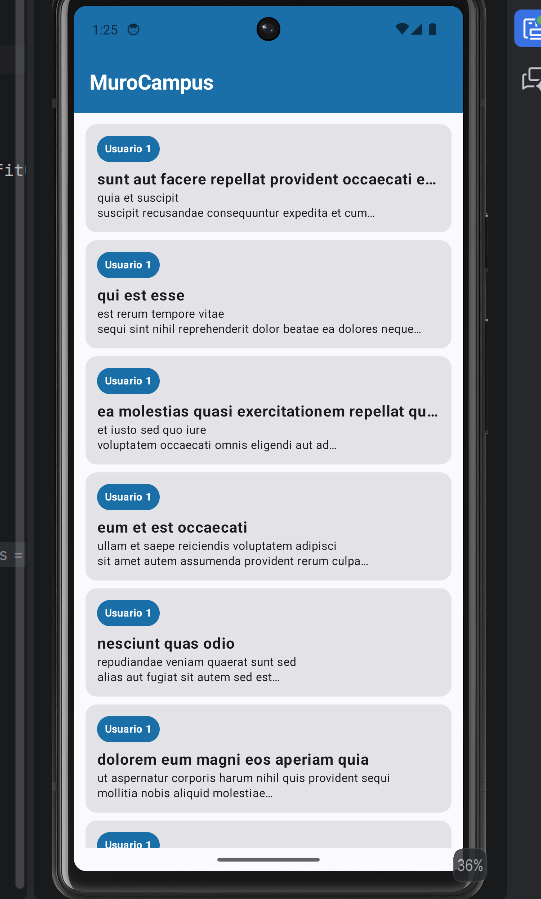
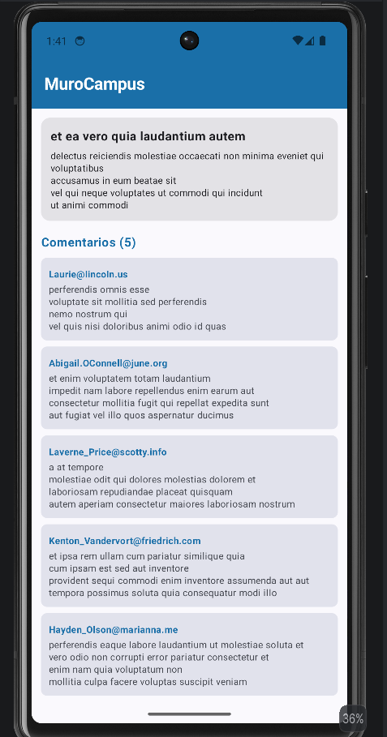
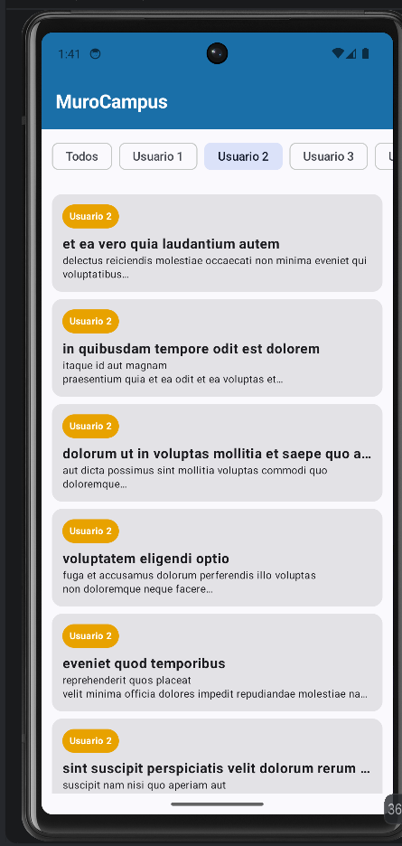
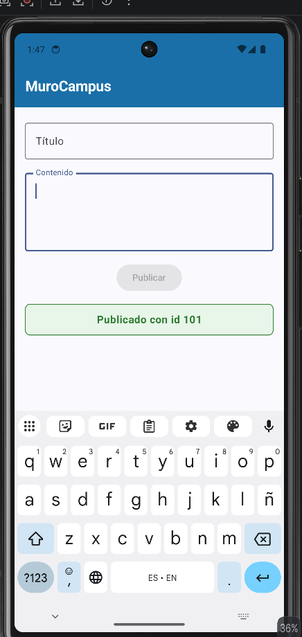
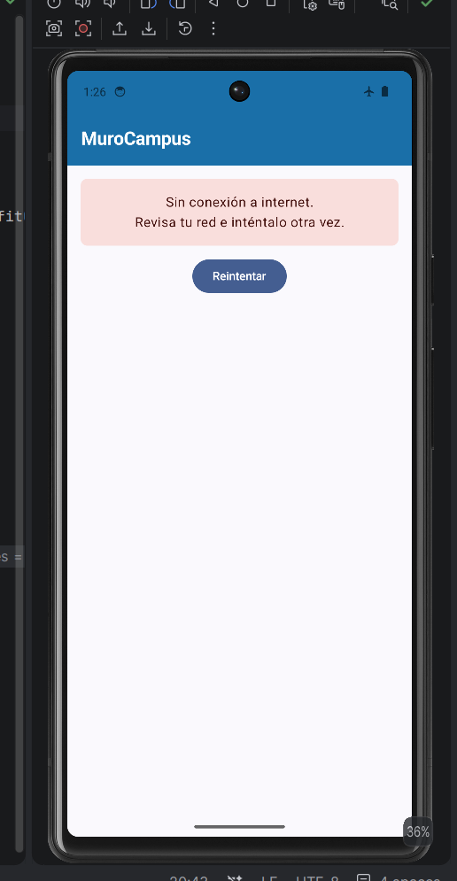

# MuroCampus

**Laboratorio 09 · Servicio Web** — Programación en Móviles (Tecsup)
**Alumno:** Luis Antonio Vasquez · **Docente:** Juan José León Suivon

## Descripción

MuroCampus es un muro de publicaciones que consume el servicio REST de
[JSONPlaceholder](https://jsonplaceholder.typicode.com/). La app permite:

- **Listar** las 100 publicaciones (`GET posts`).
- **Ver el detalle** de una publicación con sus comentarios (`GET posts/{id}` y `GET posts/{id}/comments`).
- **Filtrar por usuario** con una fila de chips (`GET posts?userId=2`).
- **Crear una publicación** (`POST posts`). JSONPlaceholder solo simula el POST: responde con `id = 101` pero no guarda nada.
- Comportarse bien **sin internet**: muestra un mensaje de error y el botón **Reintentar**.

Tecnologías: Kotlin, Jetpack Compose, MVVM, Retrofit, OkHttp, kotlinx.serialization y corrutinas.

## Arquitectura (MVVM + Repository)

```
View (PantallaLista, PantallaDetalle, PantallaCrear)
   |  eventos: cargar, filtrar, abrir, publicar     ^ collectAsStateWithLifecycle()
   v                                                |
ViewModel (PostsViewModel) --- StateFlow<UiState> (Cargando / Exito / Error) --->
   |  viewModelScope.launch
   v
PostRepository (interface)  <- devuelve Result<...>
   -> PostRepositoryRemote   (captura las excepciones de red)
   |
   v
PostApi (Retrofit) --- OkHttp ---> https://jsonplaceholder.typicode.com/
```

Reglas que se cumplen: el ViewModel no conoce Retrofit, `PostApi`, `HttpException` ni `Context`,
y ningún composable llama a la API.

## Estructura de paquetes

```
com.tecsup.murocampus/
├── MainActivity.kt
├── model/
│   └── Modelos.kt                 Post, Comentario, NuevoPost
├── data/
│   ├── remote/
│   │   ├── PostApi.kt             interface de Retrofit (@GET, @POST, @Path, @Query, @Body)
│   │   └── RetrofitClient.kt      cliente único (OkHttp + conversor JSON)
│   └── PostRepository.kt          interface + PostRepositoryRemote (devuelve Result)
├── viewmodel/
│   ├── UiState.kt                 Cargando / Exito / Error
│   ├── PostsViewModel.kt          lista, detalle, filtro y crear
│   └── PostsViewModelFactory.kt
└── ui/
    ├── Componentes.kt             TarjetaPost, Cargando, ErrorConReintento
    ├── PantallaLista.kt           lista + chips de filtro
    ├── PantallaDetalle.kt         publicación + comentarios
    ├── PantallaCrear.kt           formulario de nueva publicación
    └── theme/
```

## Capturas

| Lista | Detalle |
|:--:|:--:|
|  |  |

| Filtro por usuario | Crear publicación |
|:--:|:--:|
|  |  |

| Error de conexión |
|:--:|
|  |

## Pruebas de errores

| Prueba | Resultado |
|---|---|
| Sin internet (modo avión) | "Sin conexión a internet" y botón Reintentar |
| Reintentar con internet | Carga la lista |
| Recurso inexistente (`posts/9999`) | "Error del servidor (404)" |
| JSON inesperado (campo exigido que no llega) | "Respuesta inesperada" |
| Detalle de una publicación | Siempre 5 comentarios |
| Filtro por usuario | Siempre 10 publicaciones |
| Crear publicación | "Publicado con id 101" |

## Para pensar

**1. ¿Qué diferencia hay entre GET y POST? ¿Por qué `crear` lleva `@Body` y `porUsuario` lleva `@Query`?**
GET lee datos y POST crea un recurso nuevo. `crear` lleva `@Body` porque envía un objeto (`NuevoPost`) convertido a JSON en el cuerpo de la petición. `porUsuario` lleva `@Query` porque es un filtro que se agrega al final de la URL (`posts?userId=2`) sobre el mismo recurso.

**2. ¿Por qué la ruta es `"posts"` y no `"/posts"`?**
Porque la URL base ya termina en `/`. Una ruta que empieza con `/` reemplazaría todo el camino de la URL base y solo conservaría el dominio.

**3. ¿Por qué el Repository devuelve `Result` en vez de dejar que la excepción llegue al ViewModel?**
Porque una llamada de red puede fallar. El Repository atrapa las excepciones y las convierte en `Result.failure`, así el ViewModel y la pantalla no conocen Retrofit ni sus excepciones, la app no se cierra por una excepción sin capturar, y se puede cambiar la fuente de datos sin tocar la pantalla.

**4. ¿Qué pasa si olvidas el permiso INTERNET? ¿Y si olvidas `ignoreUnknownKeys` y el servidor agrega un campo nuevo?**
Sin el permiso la app compila pero nunca se conecta: aparece un error de red aunque haya internet. Sin `ignoreUnknownKeys`, un campo nuevo que el modelo no conoce provoca una `SerializationException`, y la app muestra "Respuesta inesperada" aunque los datos que necesita sí llegaron.

**5. ¿Por qué la pantalla de lista usa un `when` sobre `UiState` y no un `if` con tres variables?**
Porque `UiState` es una `sealed interface`: solo puede estar en un estado a la vez y el compilador obliga a cubrir todos los casos. Con tres variables podrían darse combinaciones imposibles, como "cargando" y "error" al mismo tiempo.

**6. JSONPlaceholder no guarda los POST. ¿Cómo cambiaría tu app si usaras un servicio real?**
Tras crear la publicación habría que refrescar la lista para verla, porque el servidor sí la guardaría con un `id` real. También se usaría el `userId` del usuario autenticado en lugar de `1`, y se agregaría autenticación (token en un encabezado) y manejo de errores como 400 o 401. La arquitectura se mantiene: los cambios quedan en `PostApi` y el Repository, sin tocar las pantallas.
