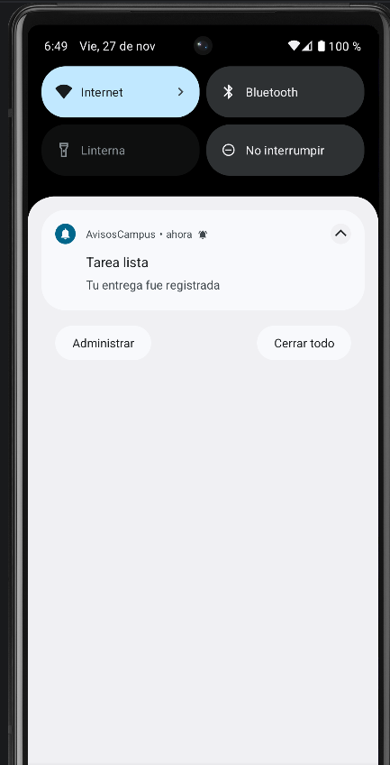
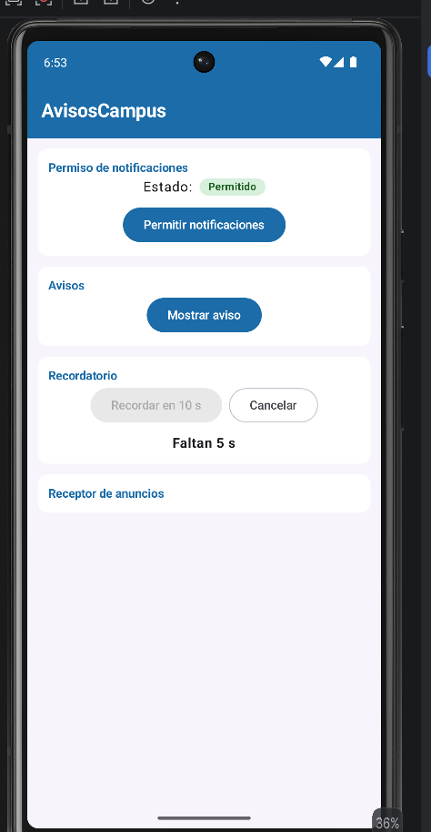
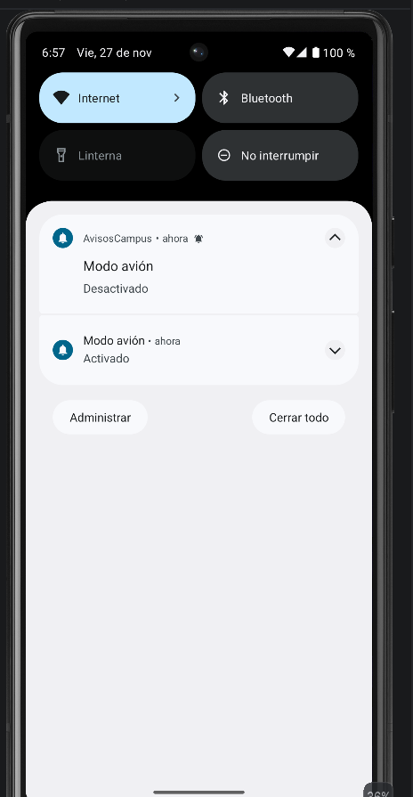
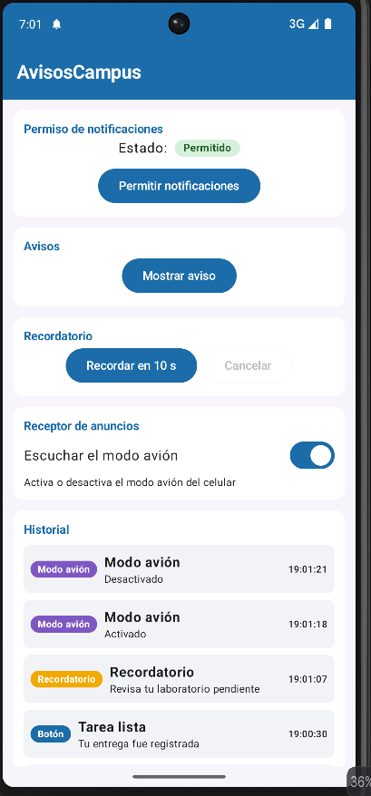
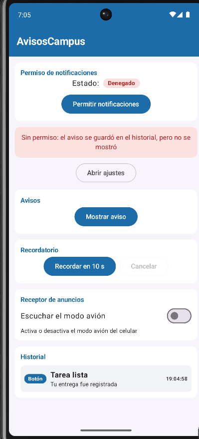

# AvisosCampus

**Laboratorio 15 · Notificaciones** — Programación en Móviles (Tecsup)
**Alumno:** Luis Antonio Vasquez Flores · **Docente:** Juan José León Suivon

## Descripción

AvisosCampus es una app que **muestra notificaciones** y **escucha lo que pasa en el celular**.
Todo es local (no usa internet ni claves) y con datos ficticios. La app permite:

- **Pedir el permiso** `POST_NOTIFICATIONS` (Android 13+) y mostrar su estado: Sin pedir, Permitido o Denegado.
- **Mostrar un aviso** con el botón *Mostrar aviso*: crea una notificación en el canal **Avisos**. Al tocarla se abre la app y la notificación desaparece (`PendingIntent`).
- **Programar un recordatorio** a los 10 segundos con cuenta regresiva y opción de cancelar (corrutinas). Llega aunque la app esté minimizada.
- **Escuchar el modo avión** con un `BroadcastReceiver` y avisar cuando se activa o se desactiva.
- Guardar todo en un **historial** (lo más reciente arriba, con origen, título, texto y hora).
- **Manejar el permiso denegado**: el aviso queda en el historial, se muestra un mensaje y el botón *Abrir ajustes*.

Tecnologías: Kotlin, Jetpack Compose, Material 3 (sin XML), MVVM + Repository, notificaciones locales y `BroadcastReceiver`.

## Arquitectura (MVVM + Repository)

```
View (PantallaAvisos)
   |  eventos: botones, switch         ^ collectAsState()
   v                                   |
ViewModel (AvisosViewModel) --- StateFlow (avisos, permiso, faltan, mensaje...) --->
   |  registra el aviso        |
   v                           v  emite: eventos (SharedFlow<Aviso>)
AvisosRepository (interface)   View recibe el evento y llama a
   -> AvisosRepositoryMemoria     Notificador.mostrar(context, aviso)
```

Reglas que se cumplen: el ViewModel **no** usa `Context`, `NotificationManager` ni `BroadcastReceiver`.
Decide qué avisar, lo anota en el Repository y emite un evento; la pantalla (que sí tiene `Context`)
llama al `Notificador`. Todo receptor registrado se quita en `onDispose`.

## Estructura de paquetes

```
com.tecsup.avisoscampus/
├── AvisosApp.kt                   Application: crea el canal «Avisos»
├── MainActivity.kt
├── model/
│   └── Modelos.kt                 Aviso, Origen, PermisoUi
├── data/
│   └── AvisosRepository.kt        interface + AvisosRepositoryMemoria
├── notificacion/
│   └── Notificador.kt             canal, permiso, mostrar y PendingIntent
├── receiver/
│   └── ModoAvionReceiver.kt       BroadcastReceiver del modo avión
├── viewmodel/
│   ├── AvisosViewModel.kt         permiso, aviso, recordatorio, receptor y errores
│   └── AvisosViewModelFactory.kt
└── ui/
    ├── PantallaAvisos.kt          tarjetas: permiso, avisos, recordatorio, receptor
    ├── HistorialAvisos.kt         tarjeta del historial
    └── theme/
```

## Capturas

| Notificación en el panel | Recordatorio |
|:--:|:--:|
|  |  |

| Modo avión | Historial |
|:--:|:--:|
|  |  |

| Permiso denegado |
|:--:|
|  |

## Pruebas de aceptación

Probadas en el emulador Pixel 6 con Android 14 (API 34).

| Prueba | Resultado esperado | OK |
|---|---|:--:|
| Ajustes → Apps → AvisosCampus → Notificaciones | Existe el canal **Avisos** | ✔ |
| Pulsar *Permitir notificaciones* | Aparece el cuadro de Android y la etiqueta cambia | ✔ |
| Pulsar *Mostrar aviso* | Aparece la notificación **Tarea lista** | ✔ |
| Pulsar *Mostrar aviso* dos veces | Aparecen dos notificaciones distintas | ✔ |
| Tocar la notificación | Se abre la app y la notificación desaparece | ✔ |
| Recordar en 10 s | Cuenta regresiva y aviso al llegar a 0 | ✔ |
| Recordar y minimizar la app | El aviso llega igual | ✔ |
| Recordar y cancelar | No llega ningún aviso | ✔ |
| Switch activado y cambiar el modo avión | Aviso **Activado** y luego **Desactivado** | ✔ |
| Switch desactivado y cambiar el modo avión | No hay aviso | ✔ |
| Permiso denegado y *Mostrar aviso* | Mensaje de error, aviso en el historial y la app no se cierra | ✔ |
| Rotar la pantalla durante el recordatorio | La cuenta regresiva continúa | ✔ |
| Revisar el código | No hay `Context` en `viewmodel/` y todo receptor registrado se quita en `onDispose` | ✔ |

## Para pensar

**1. ¿Por qué una notificación necesita un canal y un permiso? ¿Qué pasa si falta cada uno?**
Desde Android 8 toda notificación debe pertenecer a un canal, que es lo que el usuario ve y configura en Ajustes (importancia, sonido). Sin canal, la notificación no se muestra. Desde Android 13 también hace falta el permiso `POST_NOTIFICATIONS`, porque el usuario debe aceptar que la app le envíe avisos. Sin el permiso (no declarado, no pedido o denegado) el sistema bloquea la notificación sin lanzar error ni cerrar la app, por eso el `Notificador` comprueba el permiso antes y devuelve `false`.

**2. ¿Por qué el ViewModel emite un evento y no muestra la notificación él mismo?**
Porque mostrar una notificación requiere `Context` y `NotificationManager`, y el ViewModel no debe conocerlos: sobrevive a la rotación y guardar un `Context` provocaría fugas de memoria. El ViewModel decide qué avisar, lo anota en el Repository y emite un evento (`SharedFlow`); la pantalla, que sí tiene `Context`, llama al `Notificador`. Así el ViewModel se puede probar sin Android, y como el `SharedFlow` no repite el último valor, el aviso no se vuelve a mostrar al rotar la pantalla.

**3. ¿Qué pasa si usas el mismo id en dos notificaciones?**
La segunda reemplaza a la primera: el sistema las identifica por su id y solo se vería una. Por eso se usa el `id` de cada aviso (que el Repository incrementa), para que cada notificación sea distinta y se acumulen en el panel.

**4. ¿Por qué `onReceive` debe ser corto y por qué hay que quitar el receptor al salir?**
`onReceive` se ejecuta en el hilo principal y el sistema espera que termine casi de inmediato; un trabajo largo congela la app y puede causar un ANR. Por eso solo avisa al ViewModel. El receptor hay que quitarlo con `unregisterReceiver` en `onDispose`: si no, queda referenciando el contexto (fuga de memoria), sigue recibiendo anuncios cuando la pantalla ya no existe y, al rotar, se registrarían receptores duplicados.

**5. ¿En qué casos usarías una notificación local y en cuáles una push de Firebase?**
Local cuando la propia app sabe que hay que avisar: un recordatorio programado, un botón, un cambio del sistema como el modo avión, y funciona sin internet. Push cuando el evento ocurre fuera del celular, en un servidor o en otro usuario (un mensaje nuevo, una nota publicada, una oferta) y la app puede estar cerrada, por lo que el aviso debe llegar desde la red.
